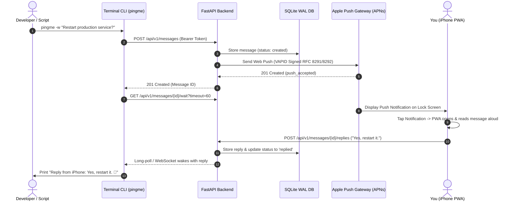

# PINGME — Terminal to iPhone Voice Messaging PWA

<div align="center">

**A production-ready, self-hostable mobile messaging system connecting any terminal to your iPhone.**  
*Push Notifications • Text-to-Speech Audio • Voice Dictation Replies • Real-Time CLI Wait*

[](backend/tests/)
[](backend/)
[](frontend/)
[](frontend/)
[](#)

</div>

---

## Highlights

- **Terminal to iPhone in Milliseconds**: Send alerts, build notifications, or interactive queries with simple shell commands (`pingme "Backup complete"`).
- **Two-Way Reply Waiting (`pingme -w`)**: Prompt your iPhone from a terminal script and pause execution until you reply by voice or text.
- **Apple Web Push (iOS 16.4+)**: Installable Safari Progressive Web App that receives real push notifications even when closed or locked. No Apple Developer Account or 7-day app-signing hassle required.
- **Full Voice Experience**: Listen to messages with Text-to-Speech (TTS) audio and reply hands-free using Speech-to-Text (STT) dictation.
- **High-Entropy Token Authentication**: Revocable API tokens stored using constant-time HMAC-SHA256 hashes.
- **Self-Hostable**: Docker Compose with Caddy automatic Let's Encrypt HTTPS reverse proxy, SQLite with WAL mode, and persistent cryptographic VAPID key vault.

---

## System Architecture



---

## Quickstart

### 1. Local Development

```bash
# 1. Setup virtual environment
python3 -m venv .venv
source .venv/bin/activate
pip install -e backend
pip install -e cli

# 2. Run backend (Terminal 1)
uvicorn backend.app.main:app --reload --port 8000

# 3. Run frontend (Terminal 2)
cd frontend
npm install
npm run dev

# 4. Use CLI (Terminal 3)
pingme doctor
pingme "Hello iPhone!"
```

### 2. Production Self-Hosting with Docker

```bash
# 1. Configure environment
cp .env.example .env
nano .env  # Set your domain and admin token

# 2. Start services (FastAPI + React PWA + Caddy HTTPS)
docker compose -f deploy/docker-compose.yml up -d --build

# 3. Check logs
docker compose -f deploy/docker-compose.yml logs -f
```

---

## iPhone Setup (iOS 16.4+)

1. Open `https://pingme.yourdomain.com` in **Safari** on your iPhone.
2. Tap the **Share** button (box with upward arrow) and select **Add to Home Screen**.
3. Tap **Add**, then launch **PINGME** from your Home Screen.
4. Go to **Settings** and tap **Enable** under Apple Web Push Notifications.
5. Tap **Allow** on the iOS system prompt.
6. Tap **Send Test Push** to verify lock screen alerts.

> [!NOTE]
> For detailed iOS installation steps, see [docs/IOS_SETUP.md](docs/IOS_SETUP.md).

---

## CLI Command Cheat Sheet

| Command | Description |
| :--- | :--- |
| `pingme "message"` | Send message to registered iPhone |
| `pingme -t "TITLE" "message"` | Send message with title header |
| `pingme --priority high "message"` | Send high-priority message |
| `pingme -w "message"` | Send message and pause waiting for iPhone reply |
| `pingme -w --timeout 120 "message"` | Wait for reply with custom 120-second timeout |
| `pingme listen` | Stream incoming replies in real-time |
| `pingme chat` | Start interactive two-way terminal chat session |
| `pingme status` | View server, push subscription, and device health |
| `pingme history -n 20` | View recent messages and reply log |
| `pingme devices` | List connected iPhones and push subscriptions |
| `pingme doctor` | Run full system connectivity and push diagnostics |
| `pingme auth login` | Configure server URL and API token interactively |
| `pingme config show` | Display local CLI settings |

> [!TIP]
> See [docs/CLI_REFERENCE.md](docs/CLI_REFERENCE.md) for scripting and automation patterns.

---

## Running the Automated Test Suite

### Run All Tests (Backend + CLI)
```bash
source .venv/bin/activate
PYTHONPATH=. pytest backend/tests/ cli/tests/ -v
```

### Test Frontend Build
```bash
cd frontend
npm run build
```

---

## Documentation Index

- [docs/INSTALLATION.md](docs/INSTALLATION.md) — Comprehensive installation and self-hosting guide
- [docs/IOS_SETUP.md](docs/IOS_SETUP.md) — iOS Home Screen installation and Web Push guide
- [docs/CLI_REFERENCE.md](docs/CLI_REFERENCE.md) — Complete CLI command manual and scripting examples
- [docs/SECURITY.md](docs/SECURITY.md) — Security model, token hashing, and cryptographic standards
- [docs/TROUBLESHOOTING.md](docs/TROUBLESHOOTING.md) — Common error diagnosis and resolutions

---

## License

MIT License. Open source and self-hostable.
