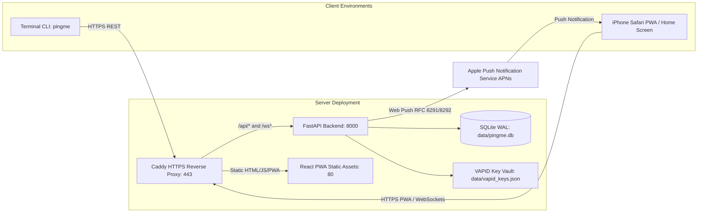

# PINGME Installation & Self-Hosting Guide

This guide covers setting up PINGME for both **local development** and **production self-hosting** with Docker and Caddy HTTPS reverse proxy.

---

## Architecture Overview



---

## 1. Local Development Setup

### Prerequisites
- Python 3.12+
- Node.js 20+ and npm
- macOS or Linux

### Step 1: Clone and Prepare Virtual Environment

```bash
git clone https://github.com/your-username/pingme.git
cd pingme

# Create Python virtual environment
python3 -m venv .venv
source .venv/bin/activate
pip install --upgrade pip

# Install backend and CLI dependencies
pip install -e backend
pip install -e cli
```

### Step 2: Start Backend Server

```bash
# In terminal 1:
source .venv/bin/activate
export SECRET_KEY="dev-secret-key-change-in-production"
export INITIAL_ADMIN_TOKEN="pm_init_admin_token_please_change"
uvicorn backend.app.main:app --reload --port 8000
```

Verify backend health:
```bash
curl http://localhost:8000/api/v1/health
```

### Step 3: Start Frontend Dev Server

```bash
# In terminal 2:
cd frontend
npm install
npm run dev -- --host
```

The frontend will start at `http://localhost:5173`.

### Step 4: Verify Terminal CLI

```bash
# In terminal 3:
source .venv/bin/activate
pingme doctor
pingme "Hello from local terminal!"
```

---

## 2. Production Self-Hosting with Docker Compose

An iPhone PWA **requires HTTPS** for Web Push notifications to function. Docker Compose deploys the FastAPI backend, compiled React PWA, persistent SQLite storage, and Caddy with automatic Let's Encrypt HTTPS certificates.

### Step 1: Server Requirements
- Linux server (Debian, Ubuntu, Arch, Rocky Linux, or Raspberry Pi 4/5)
- Public IP address with ports **80** and **443** open
- Domain name pointing to your server's public IP (e.g., `pingme.yourdomain.com`)
- Docker and Docker Compose installed

### Step 2: Configure Environment

```bash
cd pingme
cp .env.example .env
```

Edit `.env`:
```ini
DOMAIN=pingme.yourdomain.com
SECRET_KEY=$(openssl rand -hex 32)
INITIAL_ADMIN_TOKEN=pm_$(openssl rand -hex 16)
VAPID_CLAIMS_SUB=mailto:admin@yourdomain.com
```

### Step 3: Launch Containers

```bash
docker compose -f deploy/docker-compose.yml up -d --build
```

Verify running containers:
```bash
docker compose -f deploy/docker-compose.yml ps
```

Check logs:
```bash
docker compose -f deploy/docker-compose.yml logs -f
```

---

## 3. Persistent Volumes & Backup Strategy

### Data Locations
- SQLite Database: `data/pingme.db` (in container: `/app/data/pingme.db`)
- VAPID Cryptographic Keys: `data/vapid_keys.json`
- Caddy TLS Certificates: `caddy_data` volume

### Backup Script

Create an automated cron backup:

```bash
#!/bin/bash
BACKUP_DIR="/backups/pingme/$(date +%Y%m%d_%H%M%S)"
mkdir -p "$BACKUP_DIR"

# Safe SQLite backup using SQLite backup command
sqlite3 /path/to/pingme/data/pingme.db ".backup '$BACKUP_DIR/pingme.db'"

# Backup VAPID keys and environment
cp /path/to/pingme/data/vapid_keys.json "$BACKUP_DIR/"
cp /path/to/pingme/.env "$BACKUP_DIR/"

echo "PINGME backup completed at $BACKUP_DIR"
```

### Restoring from Backup

1. Stop containers:
   ```bash
   docker compose -f deploy/docker-compose.yml down
   ```
2. Replace `data/pingme.db` and `data/vapid_keys.json` from your backup.
3. Start containers:
   ```bash
   docker compose -f deploy/docker-compose.yml up -d
   ```
